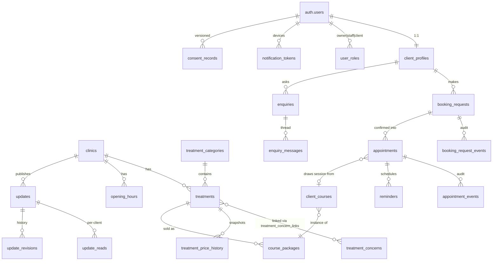

# docs/schema — Database Schema Proposal (v1 draft)

Status: **PROPOSED — nothing here is signed off.** All tables inherit the repo's evidence rules:
website (`docs/product/00-source-inventory.md` W01–W08) > this repo > M01 staff message. Money is
integer pence (R05). UK spelling (R09). Single-tenant runtime with multi-tenant shape (`clinic_id`
on every business row, ADR-002).

## Files

| File | Covers |
|---|---|
| [01-architecture-strategy.md](01-architecture-strategy.md) | Why the model is shaped this way; context mapping; design decisions; mobile optimisation |
| [02-core-tables.md](02-core-tables.md) | Every table: purpose, key fields, relationships, delete rules |
| [03-security-and-privacy.md](03-security-and-privacy.md) | Data tiers, RLS matrix, encryption, audit, GDPR deletion |
| [04-edge-cases-and-open-questions.md](04-edge-cases-and-open-questions.md) | Contradictions found in sources; 5 critical edge cases; proposed Batch 2 questions |

## Naming continuity

Table names here are the exact names already used by `docs/schema-coaching/01-user-stories.md`
(`treatments`, `booking_requests`, `client_profiles`, `consent_records`, `reminders`, …) so the
stories, this proposal, and the future `supabase/schema.sql` + `supabase/rls.sql` deliverables
never diverge. `checkConnection()` in `lib/supabase.ts` targets `treatments` — applying this schema
resolves its current `PGRST205` state ("demo schema not applied yet").

## Entity map (overview)

Dormant clinical partition (`clinical` schema: Fitzpatrick assessments, medical screening,
signed consents, progress media) is designed in 02 §E and firewalled in 03, but **gated on Q03** —
not applied in v1.

## Gate discipline

Per `AGENTS.md`, no product schema is applied before the gate process allows it. This folder is
Phase-1 documentation. The append-only registers (`05-decision-log.md`,
`07-questions-for-client.md`) are **not edited by this proposal**; Batch 2 questions proposed in
04 get appended there only once accepted.
